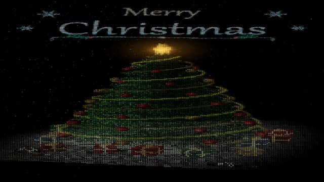

# Christmas ASCII

눈덩이가 떨어져 눈 원반이 되고, 그 위에 크리스마스 트리가 자라나는 Python/pygame 애니메이션입니다.



기본 화면은 **전체를 왼쪽 90도로 회전한 출력**입니다. 모니터를 물리적으로 세워 사용할 수 있으며 Windows 표시 방향은 가로로 둡니다.

## 실행

Windows, Python 3.10 이상이 필요합니다.

1. 이 폴더에서 `setup.bat`을 실행합니다. 전용 `.venv`를 만들고 필요한 라이브러리를 설치합니다.
2. `run.bat`을 실행합니다.

PowerShell에서 직접 실행할 수도 있습니다.

```powershell
py -3 -m venv .venv
.\.venv\Scripts\python.exe -m pip install -r requirements.txt
.\.venv\Scripts\python.exe tree.py
```

## 조작

| 키 | 동작 |
|---|---|
| 1 | 회전 없는 가로 화면 |
| 2 | 왼쪽 90도 회전 화면 |
| F11 | 전체화면 / 창 모드 |
| Space | 일시정지 / 재생 |
| R | 눈덩이 낙하부터 다시 재생 |
| S | 현재 출력 화면을 captures에 저장 |
| Esc | 종료 |

```powershell
# 창 모드
.\.venv\Scripts\python.exe tree.py --windowed
# 가로 화면으로 시작
.\.venv\Scripts\python.exe tree.py --orientation landscape
# 창 없이 50초 시점의 실제 출력 저장
.\.venv\Scripts\python.exe tree.py --export preview.png --time 50
```

## 연출

- 큰 ASCII 눈덩이의 낙하, 충돌 섬광과 원형 충격파, 퍼졌다 모이는 눈 입자
- 눈 바닥과 돌·풀·잔가지·솔방울, 전체의 시계 방향 회전
- 아래층부터 자라는 초록 트리와 흰색 생성 전선, 반짝이는 흰 점 장식
- 금빛 나선 장식줄, 빨강·금색 구슬, 꼭대기 별의 섬광과 주기적인 따뜻한 빛
- 하늘에서 하나씩 떨어지는 선물 상자와 두 번째 발광 노란 나선
- 트리 완성 후 나타나는 ASCII Merry Christmas와 얼음 장식, 가끔 빛나는 문구와 눈

설치된 Gabriola 또는 Segoe Script 글꼴은 문구의 모양 마스크로만 사용하며 최종 문구도 ASCII로 표시합니다. 해당 글꼴이 없으면 대체 글꼴을 사용합니다. 별도 이미지나 참고 사진은 실행에 필요하지 않습니다.

기본 출력은 전체화면이며 OS 단축키를 차단하는 키오스크 잠금은 포함하지 않습니다. EXE 패키지도 포함하지 않습니다. NumPy와 pygame-ce만 필요합니다.

## 구조

- `tree.py`: 실행, 화면 회전, 키 입력
- `winter_scene.py`, `ascii_surface.py`, `rotating_stage.py`: 3D 눈 지형과 ASCII 렌더링
- `ground_details.py`, `stage_motion.py`: 겨울 소품과 공통 회전
- `impact_intro.py`: 눈덩이 충돌과 입자 연출
- `growing_tree.py`, `tree_decorations.py`: 트리 성장과 장식
- `christmas_finale.py`, `christmas_greeting.py`: 별·선물·조명과 인사말

자세한 구현 기록은 [docs/IMPLEMENTATION.md](docs/IMPLEMENTATION.md)에 있습니다. 이 기록의 예전 로컬 경로나 생성 GIF는 개발 이력이며, 새 설치에서는 위 실행 절차를 사용하세요.
